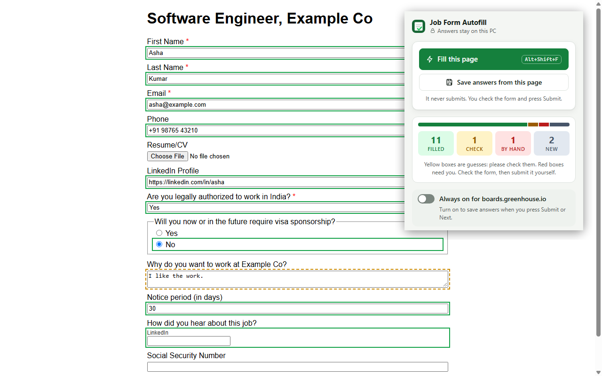

# Job Form Autofill

Fill in a job application once. Every application after that fills itself from your saved answers, which never leave your computer.

[](https://github.com/R-Dilipkumar/job-form-autofill/releases)
[](LICENSE)
-4285F4)




## Features

- **Fills job forms from your saved answers.** It reads each field's question (its label), finds your answer, and fills it in. Works with text boxes, dropdowns, radio buttons, checkboxes, and the custom dropdowns many job sites use.
- **Learns as you apply.** When you press Submit, Next or Save and Continue, your answers are saved. You can also press **Save answers from this page** in the popup.
- **New questions list.** Questions it doesn't know yet go to a list in the popup. Answer once there and it's reused from then on. Yes/No and other short choices are one-click buttons.
- **Shows what it did.** After each fill the popup shows a summary bar: filled, to check, by hand, and new questions. On the page, a solid green outline means filled from a saved answer; dashed yellow means a guess, please check (a similar question, or the closest dropdown choice, such as "Engineering" for your "Mechatronics Engineering"); dotted red means it has an answer but couldn't set it, so fill it yourself. The line style differs too, so it reads without colour.
- **Easy to manage.** The Manage answers page groups your answers (About you, Links, Where you are, Work, Education, other), with search, quick edit and a bin button on each. Light and dark mode follow your system.
- **Fits each site's format.** Number boxes get a number ("Notice period (in days)" gets 0 from "Immediate joiner"; "CTC in INR" gets 600000 from "6 LPA"). Place boxes (Lever, Google Places) get a pick from the site's own suggestion list. Phone boxes with a country-flag picker are handled.
- **Keeps your wording.** When you save, a dropdown choice that still fits your answer doesn't replace it, so "Mechatronics Engineering" stays as you wrote it. A different choice (No instead of Yes) does replace it.
- **Never submits.** It fills fields only. You check the form and press Submit yourself.
- **Stays on your computer.** No account, no server, no tracking, no AI. Your answers are kept in Chrome's local storage on this PC only.
- **Leaves sensitive fields alone.** It never fills or saves passwords, ID numbers (SSN, Aadhaar, PAN, passport) or bank and card details. It never ticks "I agree" or consent boxes, never answers "I confirm / I understand" questions or "may we contact you" permission boxes, and never touches CAPTCHA or bot checks.
- **Repeated sections.** For forms with several jobs or schools, it remembers each entry and fills them in order.
- **Common fields work across sites.** Name, email, phone, LinkedIn, GitHub, city, location, notice period, current and expected salary, work authorisation, sponsorship, relocation, school, degree, field of study, CGPA, graduation year and more are recognised however each site words them. Full name is built from first and last name, or split the other way.
- **Backup file.** Download your answers as a file and load them on another computer.
- **Keyboard shortcut:** `Alt+Shift+F` fills the page without opening the popup.

## Download and install

**From the Chrome Web Store:** coming soon.

**By hand (works now):**
1. Download `job-form-autofill-<version>.zip` from the [latest release](https://github.com/R-Dilipkumar/job-form-autofill/releases) and unzip it into a folder you'll keep.
2. Open `chrome://extensions` and switch on **Developer mode** (top right).
3. Click **Load unpacked** and pick the unzipped folder.
4. Pin the extension (puzzle-piece icon → pin) so its button is always visible.

## Setup and use

1. Open a job application page and click the extension's button, then **Fill this page**.
2. The first time, it knows nothing: fill the form yourself and press Submit or Next as usual. If the site didn't save your answers automatically, press **Save answers from this page** before you submit.
3. On the next application, press **Fill this page** again. Known answers fill in; new questions appear in the popup. Answer them there, then press Fill again.
4. Optional: flip the **Always on for this site** switch (in the popup) for sites you use a lot. On those sites it saves your answers whenever you press Submit or Next, even if you didn't press Fill, and it can reach forms embedded from another site (for example a Greenhouse form inside a company's careers page).
5. **Manage answers** (popup footer) lets you edit, delete, add, back up and restore answers.

## How it works

For each field on the page it reads the question from the field's label (or the text next to it), cleans it up, and looks for a saved answer:

1. Common fields (name, email, phone, LinkedIn, salary, notice period…) are matched by meaning, so "Mobile" and "Phone number" both use your phone answer.
2. Other questions are matched by their exact words, then by similar wording ("Why would you like to work here?" ↔ "Why do you want to work here?"). Similar-wording matches are marked yellow for you to check. Common-field rules only apply to short labels, so a long legal question that mentions "current employer" isn't taken for "Current company".
3. Dropdown and radio answers are matched to the option text on each site ("Yes" picks "Yes, I am authorized"). For type-to-search dropdowns it opens the list first and picks from it, and only types to search when the answer isn't there (long school or place lists).

It runs only when you press Fill or the shortcut (Chrome's `activeTab` access), or on sites you turned on.

## Good to know / limits

- **Resume upload:** browsers don't let extensions attach files, so attach your resume yourself.
- **Multi-step forms:** press Fill again on each step.
- **Unusual custom dropdowns** may not open for it; it marks them red so you can pick by hand.
- **Guesses can be wrong**, for example a company-specific "Why do you want to join X?" answer reused for another company. Always read the form before you submit.
- **Your data lives in this browser profile.** Removing the extension deletes it, so download a backup now and then.
- **Tested on real forms (Nov 2026):** 10 live applications on Greenhouse (including one embedded in a company careers page), Lever, Ashby, Workable and Teamtailor, without submitting. Typical result: all the common fields fill; what's left are company-specific questions, which go to your new-questions list. Plus 45 automatic checks in real Chrome: test pages built like Greenhouse, Lever and Workday forms, and the popup and Manage answers page (every control has a name for screen readers, hidden parts stay hidden). All text colours pass WCAG AA contrast in light and dark mode.
- **Not tried yet:** Workday, iCIMS and Naukri (they need an account first), LinkedIn Easy Apply (needs sign-in), SmartRecruiters and Keka (they blocked the automated test browser). They may work; please open an issue if one doesn't.
- **School lists:** if your college isn't in a site's list, it's marked red; pick "Other" yourself.

## Privacy

Nothing is sent anywhere. The extension makes no network requests and has no analytics. Full policy: [privacy policy](https://r-dilipkumar.github.io/job-form-autofill/privacy.html).

## Build from source

Needs Node.js 20+ (tests), Python 3 with Pillow (icons, store images, zip) and Google Chrome.

```
git clone https://github.com/R-Dilipkumar/job-form-autofill.git
cd job-form-autofill
npm test            # matching rules (Node)
npm run e2e         # loads the extension into headless Chrome and fills the test pages
npm run zip         # makes dist/job-form-autofill-<version>.zip for the Chrome Web Store
npm run live        # opens a visible Chrome test window (own profile) you can drive on real sites
```

`npm run live` starts Chrome with a separate test profile, loads the extension, and takes commands on `http://127.0.0.1:47321` (open a page, fill, save, list the questions it reads, screenshot). See the top of `tests/live.js`. It never submits anything.

To try your changes, load the folder itself with **Load unpacked** and press the reload button on `chrome://extensions` after each change.

Project layout: `manifest.json`, `src/` (page script, matching rules, storage, background worker, shared styles, icons and new-question cards), `popup/`, `options/` (Manage answers page), `icons/`, `tests/` (unit tests, end-to-end test, test pages), `tools/` (icons, store images, zip), `store/` (Web Store listing text and images), `docs/` (privacy policy page).

## License

[MIT](LICENSE) © 2026 Dilipkumar R
